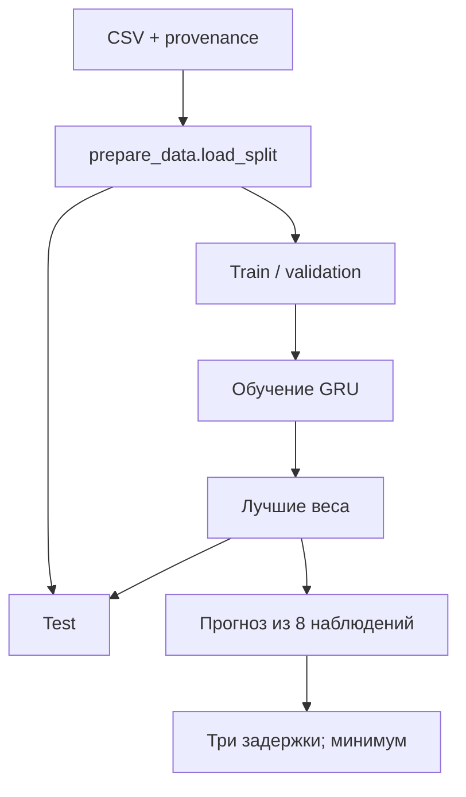

# Устройство программы СМ7

Один исходный CSV: `data-project/traffic_delays.csv`. Шаг 15 минут, окно 8 × 3, горизонт 60 минут. На выходе три задержки в минутах и рекомендация направления с минимальной задержкой.

| Модуль | Назначение |
|---|---|
| `data-project/prepare_data.py` | Проверка CSV, формирование окон, сохранение границ источников |
| `model.py` | GRU(3,32), выход 32→3, Softplus |
| `run.py` и `gui.py` | Консольные команды и окно |
| `environment.py`, `setup.ps1` | Проверка и создание среды |
| Будущие train/evaluate/predict | Обучение, оценка, использование готовых весов |

При обучении используются только train и validation. Лучшая эпоха определяется по MSE на validation; test используется только для итогового сравнения. Метрики: MAE в минутах, доля правильных рекомендаций с учётом равенства минимумов, средняя дополнительная задержка.

Прогноз получает восемь прошлых наблюдений без будущих значений. После загрузки лучшей модели сеть выдаёт три оценки задержки через 60 минут; при равном прогнозируемом минимуме выбирается первое направление A/B/C. Оценка и прогноз не изменяют веса.

Статус: загрузка данных, проверка окон, GRU и техническая проверка реализованы. Полный цикл обучения, оценки и прогноза ещё не реализован. Веса и результаты должны сохраняться в `models/` и `results/` отдельно.
