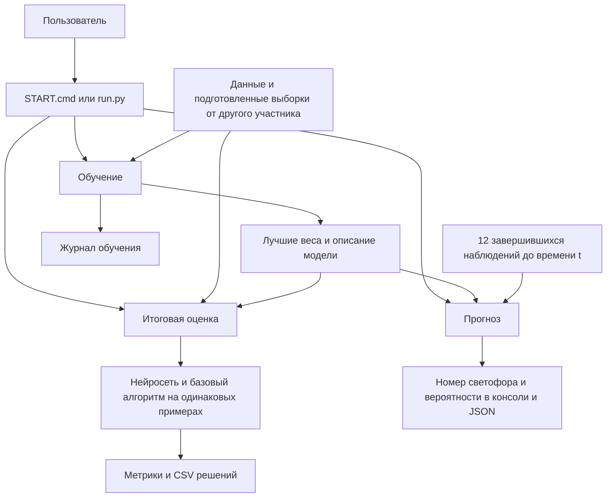

# Устройство программы СМ7

Программа запускается локально и выбирает светофор с минимальной ожидаемой плотностью в следующем пятиминутном интервале. Архитектура состоит из независимых модулей с общей консольной точкой входа. Подготовка модели и её использование выполняются раздельно.

## Общая схема



Данные на схеме — внешний для текущего этапа модуль. Его реализация и содержание исходного набора остаются за ответственным участником. Граница подключения описана в [interfaces.md](interfaces.md).

## Модули и направления зависимостей

| Модуль будущей реализации | Ответственность | От чего зависит |
|---|---|---|
| `cli` | Меню и разбор отдельных команд | Сценарии train, evaluate, predict |
| `data_adapter` | Подключение проверки и подготовки данных коллеги | Согласованный интерфейс данных |
| `model` | GRU и линейный слой | Только PyTorch и параметры архитектуры |
| `train` | Обучение, валидация, ранняя остановка | Модель, обучающая и валидационная выборки |
| `artifacts` | Сохранение и загрузка весов с метаданными | PyTorch и файловая система |
| `predict` | Применение сохранённой модели | Модель, артефакты, входное окно |
| `baseline` | Выбор минимума последней строки | Только три последние плотности |
| `metrics` | Accuracy, F1-macro, избыток плотности, матрица ошибок | Метки, решения, фактические плотности |
| `evaluate` | Сопоставление двух алгоритмов на тесте | predict, baseline, metrics, тестовая выборка |

Модель не читает CSV, не выбирает файлы и не вычисляет метрики. Прогноз не импортирует запуск обучения. Метрики не изменяют веса. Такое разделение позволяет заменить внутреннюю реализацию данных без изменения модели и меню.

## Сценарий обучения

1. Получить отдельно обучающую и валидационную выборки через адаптер. Тестовую выборку не открывать.
2. Установить seed 42 для Python, NumPy и PyTorch, создать модель на CPU.
3. Обучать по параметрам `config.json`, включая последний неполный пакет.
4. После каждой эпохи считать среднюю валидационную потерю в режиме `eval` без градиентов. Среднюю потерю по эпохе взвешивать по числу примеров в пакетах.
5. Сохранять веса только при строго меньшей валидационной потере. Равенство не считается улучшением.
6. Завершить после пяти эпох без улучшения либо после 30-й эпохи. Сохранить журнал, лучшую эпоху и настройки.

## Сценарий прогноза

Пользователь задаёт историю и время t. Адаптер возвращает 12 последовательных наблюдений до t включительно. После деления на 200 модель выдаёт три оценки классов. Softmax преобразует их в вероятности; выбирается первая максимальная вероятность и к индексу добавляется единица. При точном равенстве получается меньший номер светофора.

Веса загружаются на CPU, включается `eval`, вычисления выполняются без градиентов. Строка из будущего не требуется. Прогноз не запускает обучение и не меняет исходный CSV. При отсутствии весов выводится причина и ненулевой код завершения.

## Сценарий оценки

Отдельная команда загружает лучшие веса и тестовую выборку. Нейросеть и базовый алгоритм получают одинаковые окна. Итог — Accuracy, F1-macro, средняя избыточная плотность, матрицы ошибок и одна строка CSV на каждый тестовый пример. Число примеров по ТЗ — 31 568. Оценка не выбирает новую эпоху и не изменяет настройки.

## Хранение и дальнейшая структура

```text
architecture/
  START.cmd                 единый запуск Windows, уже работает
  run.py                    меню и команды каркаса, уже работает
  config.json               параметры по ТЗ
  docs/                     схемы, обоснование, интерфейсы
  data/                     место подключения входных файлов
  models/                   веса и метаданные
  results/                  журналы, прогнозы и метрики
  src/sm7/                  будущие модули из таблицы
  tests/                    будущие проверки требований
  requirements.txt          будет зафиксирован после проверки среды ML
```

Каталоги `src/sm7`, `tests` и файл зависимостей будут добавлены при реализации соответствующих частей. Сейчас они показаны как проект структуры. Все пути разрешаются относительно `architecture`, а не текущей папки терминала.
